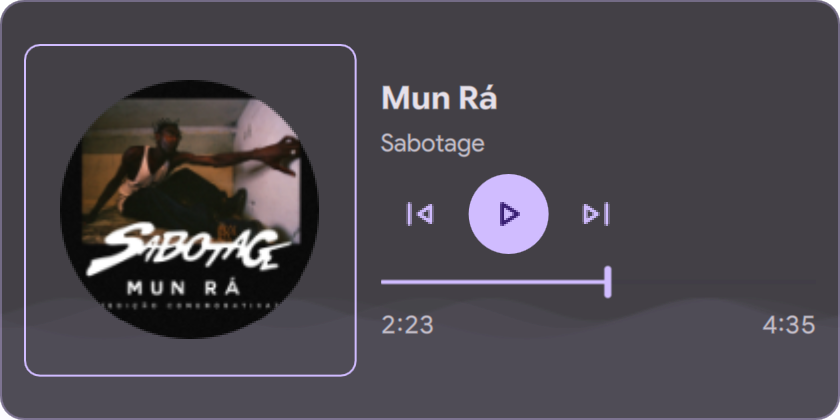

# Media Player

**A desktop MPRIS player for [Dux Shell](https://github.com/duxlabs-dev/dux-shell) (DMS) 2.0.**

[](https://github.com/bernardopg/mediaPlayer/actions/workflows/check.yml)




Album art spinning like a record, previous/play/next, a seekbar and an
optional wave background, sitting on your desktop. It follows whichever player
DMS considers active (Spotify, mpv, VLC, Firefox, Chromium and anything else
that speaks MPRIS) and hides itself when nothing is playing.

## Features

- **Uses the shell's media stack.** The active player, track metadata and
  album art come from DMS's `MprisController` and `TrackArtService`, so the
  widget always agrees with the bar, the dash and the lock screen. The plugin
  itself starts no processes and downloads nothing; remote art is cached by
  the shell, as it already is for the bar.
- **Cheap to keep on screen.** No polling timers: the seekbar shares DMS's
  position updates, which only run while something is playing and the widget
  is visible. The wave background is painted once and only moved, and every
  animation pauses when playback stops, when the widget is hidden and when
  *Reduce motion* is on.
- **Native controls.** `DIconButton`s and `DSeekbar` with Theme colors, sizes
  and accessible names. Buttons disable themselves when the player cannot go
  back, forward or pause. Previous rewinds the track after 8 seconds.
- **Long tracks.** Times switch to `h:mm:ss` past one hour, and the elapsed time
  follows the seekbar while you drag it.
- **Translated.** English and Brazilian Portuguese, through the plugin's own
  `translations/` catalog.

## Install

From **Settings → Plugins → Browse**, search for *Media Player* and install it.
Then add it from **Settings → Desktop Widgets**.

To install from source:

```sh
git clone https://github.com/bernardopg/mediaPlayer ~/.config/DankMaterialShell/plugins/mediaPlayer
```

Enable it under **Settings → Plugins**, then add the widget from
**Settings → Desktop Widgets**.

## Settings

| Setting | Default | What it does |
| --- | --- | --- |
| Background opacity | 80% | Opacity of the card behind the player. |
| Border opacity | 100% | Opacity of the album art frame; the card outline follows at a lower strength. |
| Rotate album art | On | Spins the album art while media is playing. |
| Wave background | On | Animated waves along the bottom while media is playing. |
| Album art backdrop | Off | A blurred copy of the album art behind the card. |
| Hide when idle | On | Hides the widget when no media is playing. Off shows a "No media playing" state. |

Each widget instance keeps its own settings.

## Requirements

- Dux Shell (DMS) **2.0.0** or newer.
- A player that exposes MPRIS on the session bus.

No other dependencies.

## Upgrading from 1.x

The plugin id is still `mediaPlayer`, so existing widgets keep their position,
size and settings. Version 2.0 drops the `curl` album art download, the `/tmp`
cache and the polling timers. See [CHANGELOG.md](CHANGELOG.md) for the full
list.

## Development

```sh
scripts/check --core   # manifest, sources, translations and unit tests; runs anywhere
scripts/check          # also the QML smoke test (needs Wayland, Quickshell and DMS 2.0)
```

The smoke test loads the widget in an isolated Quickshell instance against the
installed DMS modules, publishes a fake MPRIS player on a private D-Bus session,
and clicks through the controls. Screenshots land in `test-results/`. See
[CONTRIBUTING.md](CONTRIBUTING.md).

## Credits

Created by [Abdur Rahman Rifat (@arrifat346afs)](https://github.com/arrifat346afs),
who transferred the repository in October 2026. Maintained by
[@bernardopg](https://github.com/bernardopg).

## License

[MIT](LICENSE)
